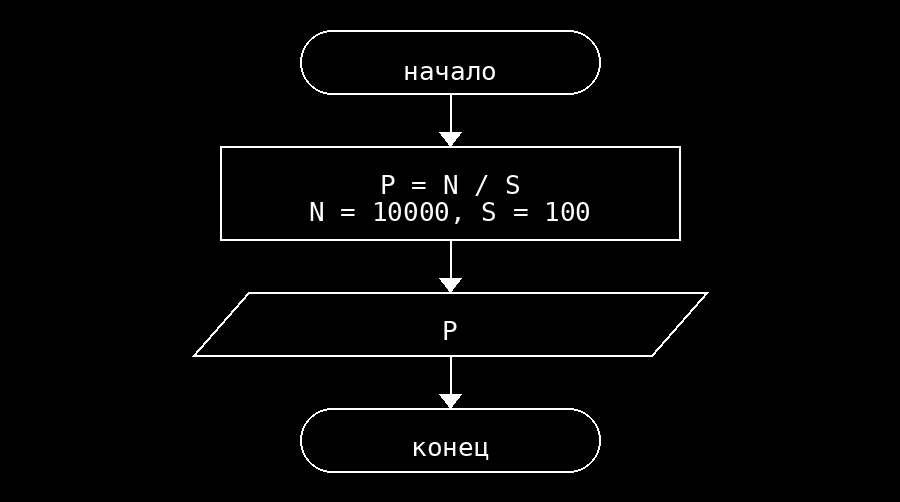

**Условие**
Найти плотность населения по заданной площади территории и числу жителей. Площадь — 100 км², число жителей — 10000.

**Блок схема**

**Контрольный пример**
Ввод: нет
Вывод: Плотность населения: 100.00 человек на км2
